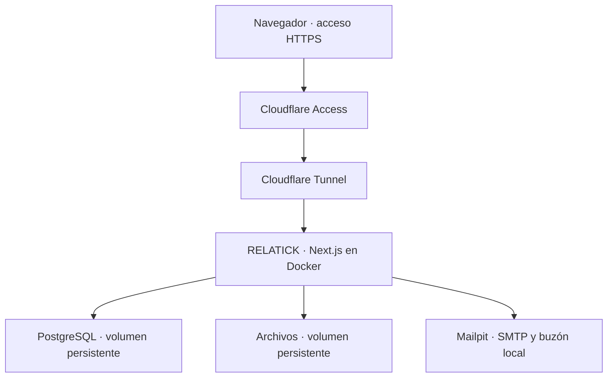

# RELATICK · Manuales y operación

[Ficha de la aplicación](relatick.md) · [Entrar en RELATICK](https://relatick.thereplicantlab.com/)

## Manuales beta

Los cuatro PDF corresponden a `v1.0.0-beta.1` y se consultan con acceso al repositorio privado de RELATICK. Las capturas de los manuales ilustran los recorridos de esa edición.

| Manual | Contenido |
|---|---|
| [Usuario](https://github.com/ratienza/RELATICK-CLAUDE/blob/0ce7998bec3a287ca3b336c02fec83bfe88085c2/docs/manuals/Relatick_Manual_Usuario_v1.0-beta.1.pdf) | Entrada, portal, Mis tickets, alta, respuesta, confirmación y reapertura. |
| [Personal IT](https://github.com/ratienza/RELATICK-CLAUDE/blob/0ce7998bec3a287ca3b336c02fec83bfe88085c2/docs/manuals/Relatick_Manual_Personal_IT_v1.0-beta.1.pdf) | Kanban, ficha, estados, alta en nombre de otra persona, avisos y estadísticas. |
| [Administrador](https://github.com/ratienza/RELATICK-CLAUDE/blob/0ce7998bec3a287ca3b336c02fec83bfe88085c2/docs/manuals/Relatick_Manual_Administrador_v1.0-beta.1.pdf) | Parametrización, accesos, supervisión, reportes y Foto del periodo. |
| [Técnico](https://github.com/ratienza/RELATICK-CLAUDE/blob/0ce7998bec3a287ca3b336c02fec83bfe88085c2/docs/manuals/Relatick_Manual_Tecnico_v1.0-beta.1.pdf) | Arquitectura, datos, despliegue, copias y resolución de incidencias operativas. |

## Arquitectura en Nexus

| Servicio | Uso |
|---|---|
| `app` | Next.js standalone, acciones del servidor, autenticación, permisos y correo. Origen Nexus en `8088`. |
| `db` | PostgreSQL en la red interna de Docker, con volumen dedicado. |
| `mailpit` | Captura SMTP. Interfaz `8089` en LAN y loopback, con datos persistentes. |
| `tools` | Perfil de ejecución puntual para migraciones y tareas autorizadas. |

## Actualizar y verificar

1. Identificar la rama, etiqueta o SHA autorizado. La beta de referencia sigue etiquetada `v1.0.0-beta.1`.
2. Usar el procedimiento versionado `scripts/deploy-pruebas.sh` desde el proyecto RELATICK. Confirmar la copia de PostgreSQL antes de las migraciones. El script construye desde el contenido del commit, transfiere imágenes y despliega en Nexus.
3. Revisar la imagen activa y la salud de los contenedores. Validar el acceso exterior y el flujo funcional con cuentas de prueba. Consultar Mailpit desde la red local.
4. Para una incidencia de despliegue, revisar la copia y la revisión anterior antes de usar el procedimiento de recuperación. Una restauración de base recupera el punto de la copia.

La receta general de Docker del manual técnico sirve como referencia de arquitectura. En Nexus se aplica el procedimiento del repositorio. Mailpit conserva el histórico y sus enlaces dentro de la red local. El correo de producción se configura y valida por separado.

## Diferencias de la versión desplegada

El [informe privado ENC-012](https://github.com/ratienza/RELATICK-CLAUDE/blob/main/docs/encargos/ENC-012.md) registra el despliegue desde `main` en `d65dde6`, la migración `20261126000000_ticket_codes` y la validación funcional con cuentas clon. Documenta el alcance de cada comprobación y mantiene la trazabilidad frente a la beta.
