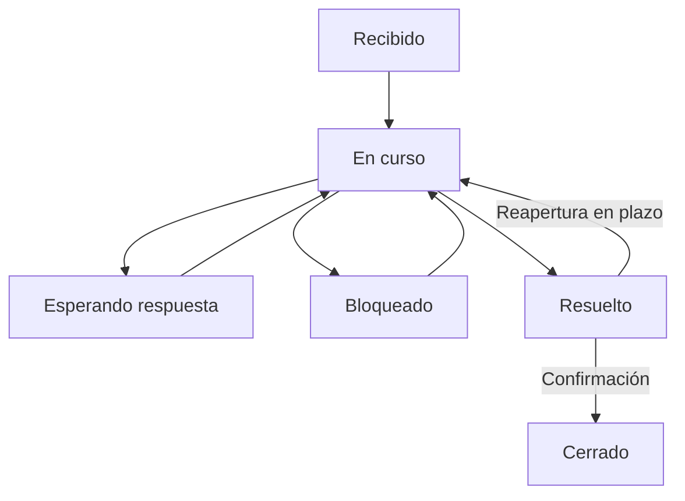

# RELATICK

Aplicación web de soporte IT de The Replicant Lab. Centraliza el alta y seguimiento de incidencias, el trabajo de los técnicos por zona y la supervisión del servicio.

[Entrar en RELATICK](https://relatick.thereplicantlab.com/) · [Manuales y operación](relatick-operacion.md) · [Nexus](../hosts/nexus.md)

| Campo | Valor |
|---|---|
| Desarrollo | Claude Code |
| Aplicación | TypeScript, Next.js 16, React 19 y Node.js 24 |
| Datos | PostgreSQL 18 y Prisma 7 |
| Despliegue | Docker Compose en Nexus |
| Identidad | Cloudflare Access en el acceso exterior y gestión de sesiones y permisos dentro de RELATICK |
| Correo en Nexus | SMTP a Mailpit con buzón persistente y acceso local |
| Referencia de los manuales | `v1.0.0-beta.1` |
| Referencia del entorno de pruebas | Despliegue de `main` documentado en ENC-012 |

## Qué puede hacer cada perfil

| Perfil | Recorrido |
|---|---|
| Usuario | Abrir incidencias, responder a IT, consultar el historial, confirmar la resolución y reabrir dentro del plazo configurado. |
| Personal IT | Trabajar en el kanban, registrar cambios y resolver tickets. Puede abrir incidencias en nombre del usuario y registrar su canal de origen. |
| Supervisión | Consultar carga, bloqueos, confirmaciones y actividad por equipo o zona según permisos. |
| Administración | Configurar organización, sedes, departamentos, servicios, dominios, usuarios, roles y alcance. Acceder a Supervisión, Reportes, CSV y Foto del periodo. |

## Ciclo de una incidencia

El diagrama resume el camino habitual. La ficha registra acciones y conversaciones. Los cambios disponibles dependen del estado y los permisos. Si vence el plazo de reapertura, el manual describe la apertura de un nuevo ticket enlazado.

## Funciones posteriores a la beta

El informe de ENC-012 registra códigos `XX-nnnn`, el buscador **Ir al ticket**, **Ausencias**, **Delegar a supervisor** y **Dirección del servicio** en Nexus. Los capítulos destacados como v1.1 en los manuales beta deben leerse junto con la revisión desplegada y sus permisos.
