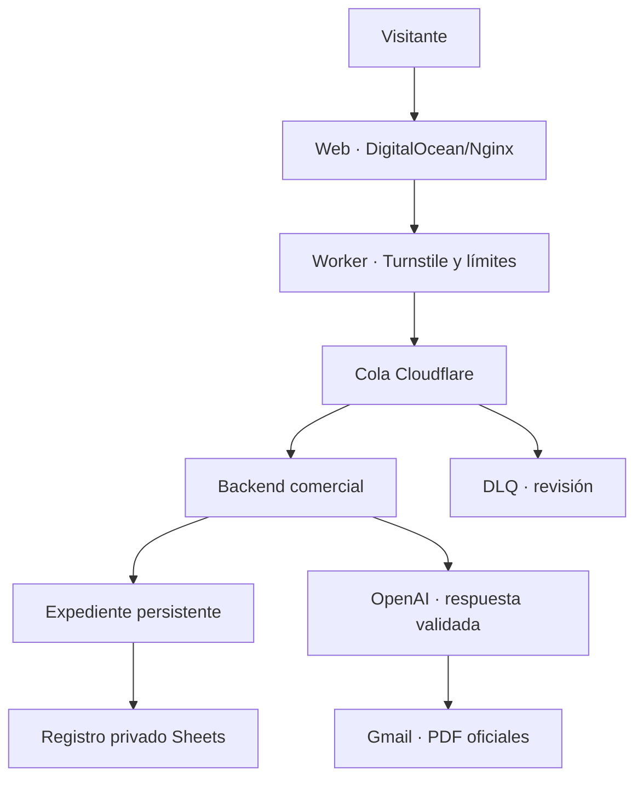

# Aplicación · Web corporativa TRL

Ficha técnica y funcional del sitio público y su sistema comercial. **Corte documental: 31/10/2026.** Se diferencia de Replicant Lab/MkDocs, que sirve esta documentación, y del Business Hub privado.

## Accesos

- [Ficha HTML](../downloads/apps/web-corporativa-trl.html) · [Ficha PDF](../downloads/apps/web-corporativa-trl.pdf).
- [Web pública](https://thereplicantlab.com/) · [Repositorio privado](https://github.com/ratienza/replicant-lab-business).

## Identificación y estado

| Campo | Estado acreditado |
| --- | --- |
| Finalidad | Presentar los cuatro servicios de TRL y recibir consultas mediante «Hablemos con inteligencia». |
| Sitio público | [thereplicantlab.com](https://thereplicantlab.com/) |
| Frontend y hosting | HTML/CSS/JavaScript estático · DigitalOcean/Nginx; Squarespace no es el hosting vigente según evidencia de continuidad. |
| Integraciones | Cloudflare Worker, Turnstile, Queues/DLQ; backend Python/FastAPI, OpenAI, Gmail y Google Sheets. |
| Repositorio | [ratienza/replicant-lab-business](https://github.com/ratienza/replicant-lab-business), privado. |
| Versiones independientes | Web `v1.0.12-phone-r1-logo-mobile-r1` acreditada 29/10; asesor operativo v1.4 desde 25/10; teléfono opcional 28/10. |
| Despliegue web | Releases y enlace activo en Nginx; el backend persistente tiene ciclo de operación propio. |
| Nexus | Centro documental; no es el runtime de la web pública ni del motor comercial. |
| Última evidencia | Publicaciones y lectura HTTPS registradas en el repositorio privado. No se despliega ni ensaya el formulario en esta auditoría. |

## Arquitectura y flujo funcional

La recepción del formulario, el procesamiento y la entrega son estados distintos. El servidor decide elegibilidad; una salida de IA no autoriza por sí misma el envío. Los PDF corporativo y de servicio se verifican antes del envío. La copia interna del correo comercial fue retirada por PR #80; no confundirla con otros avisos operativos.

## Seguridad y persistencia

Turnstile, validación, límites, firma entre consumidor y backend, idempotencia y conciliación de recibos. Los casos sensibles o inciertos conservan revisión humana. Secretos y datos reales permanecen fuera de este repositorio público. La base comercial SQLite, la hoja privada y los buzones tienen ciclos de conservación distintos; no son datos de Nexus/MkDocs.

## Operación, backup y rollback

La web conserva releases anteriores para rollback; el motor conserva expedientes y recibos para conciliar entregas inciertas. Los backups y la recuperación del backend se documentan en el runbook privado; no se considera cubierto por Backups Lab sin contrato específico verificado. La respuesta HTTP 202 del formulario no demuestra recepción del correo.

DNS, SSL, remitente, OAuth, colas, servicios, última copia y restauración necesitan evidencia administrativa fechada para volver a validarse. Esta auditoría no cambia dominios, certificados ni autenticación. La publicación técnica no equivale a conformidad jurídica completa.

## Documentación privada vinculada

El repositorio de infraestructura es público. **No copiar aquí contactos, campañas, preguntas/respuestas, precios internos, plantillas contractuales ni secretos.** Nexus ofrece el índice; la documentación privada exige sus propios permisos.

| Área | Fuente canónica privada |
| --- | --- |
| Arquitectura integral, módulos, configuración, seguridad y runbook | [Ficha integral](https://github.com/ratienza/replicant-lab-business/blob/main/docs/06-web/arquitectura-y-operacion-20261031.md) · disponible en main tras integrar su PR. |
| Versiones y despliegues | [Historial web](https://github.com/ratienza/replicant-lab-business/blob/main/docs/06-web/estado-y-versiones.md) |
| Identidad, infinito y lema | [Manual integral 2.0 y originales](https://github.com/ratienza/replicant-lab-business/blob/main/docs/04-identidad/manual-integral.md) |
| Catálogo, dossiers y condiciones | [Servicios](https://github.com/ratienza/replicant-lab-business/blob/main/docs/03-comercial/servicios.md) |
| Campañas y actividad | [Índice privado](https://github.com/ratienza/replicant-lab-business/blob/main/docs/03-comercial/campanas/index.md) |
| Roadmap, changelog y ADR | [Business Hub en Git](https://github.com/ratienza/replicant-lab-business/tree/main/docs) |

## Publicación documental

Esta ficha genera [HTML](../downloads/apps/web-corporativa-trl.html) y [PDF](../downloads/apps/web-corporativa-trl.pdf) mediante el pipeline canónico. Rama, PR, CI, main y runtime se verifican por separado. No declarar Nexus actualizado por hacer push. [Corte de auditoría](../cambios/2026-10-31.md).
